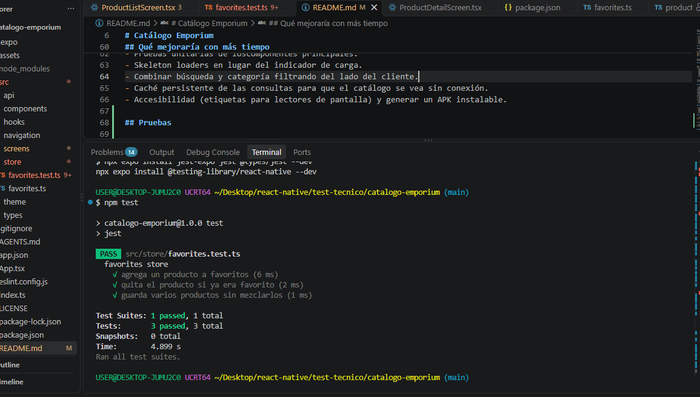

# Información
- David Llumitaxi
- Evaluación técnica React Native


# Catálogo Emporium

App móvil de catálogo de productos hecha con React Native (Expo) y TypeScript, que consume la API pública [DummyJSON](https://dummyjson.com/docs/products).

## Funcionalidades

- Listado de productos con imagen, nombre, precio y rating.
- Scroll infinito (paginación) y pull-to-refresh.
- Búsqueda por texto con debounce.
- Filtro por categoría.
- Detalle del producto con galería de imágenes, descripción, precio, stock y rating.
- Favoritos: agregar o quitar desde el detalle, pantalla propia y persistencia al cerrar la app.
- Estados visibles de carga, error (con botón de reintentar) y lista vacía.

## Cómo ejecutar el proyecto

Requisitos: Node.js (versión LTS), npm y la app **Expo Go** en un celular, o un emulador de Android.

```bash
git clone https://github.com/WashingtonLlumitaxi/catalogo-emporium.git
cd catalogo-emporium
npm install
npx expo start
```

Escanea el código QR con Expo Go (el celular y el PC deben estar en la misma red Wi-Fi). Para abrirla en un emulador de Android, presiona `a` en la terminal. Si la red bloquea la conexión, usa `npx expo start --tunnel`.

## Estructura del proyecto

```
App.tsx                 Providers y navegación raíz
src/
  api/                  Único lugar que hace peticiones HTTP
  types/                Tipos de los datos de la API
  store/                Estado global (favoritos)
  hooks/                Lógica reutilizable (datos, debounce)
  components/           Componentes visuales reutilizables
  screens/              Pantallas
  navigation/           Navegadores y tipos de rutas
```

Las dependencias van en un solo sentido: `screens → components, hooks, store → api → types`. Cada carpeta tiene una responsabilidad, lo que aísla los cambios: si cambia un endpoint solo se toca `api/`, y si cambia el diseño, `components/`.

## Decisiones técnicas

- **Expo + TypeScript:** arranque rápido sin configurar herramientas nativas, y tipos para evitar errores y `any`.
- **React Navigation (stack + tabs):** un stack nativo contiene las pestañas (Catálogo y Favoritos) y el detalle. El detalle queda sobre las pestañas, sin barra inferior.
- **TanStack Query para datos del servidor:** `useInfiniteQuery` resuelve paginación, caché, reintentos y estados de carga y error con muy poco código. Al incluir el texto de búsqueda y la categoría en la `queryKey`, cada combinación se cachea por separado.
- **Zustand + persist (AsyncStorage) para favoritos:** estado global pequeño y sin boilerplate, con persistencia entre sesiones. Elegí Zustand sobre Redux o Context porque el estado global es mínimo y no justifica más estructura. Se guarda el producto completo, no solo el id, para mostrar la pantalla de favoritos sin otra petición.
- **Búsqueda y categoría son excluyentes:** la API de DummyJSON no permite combinarlas. Escribir en el buscador limpia la categoría, y elegir una categoría limpia el texto.
- **Debounce de 400 ms:** evita una petición por cada letra escrita.
- **Pantallas delgadas:** las pantallas solo combinan hooks y componentes; la lógica vive en `hooks/` y `api/`.
- **Componentes de estado reutilizables:** `LoadingView`, `ErrorView` y `EmptyView` se usan en varias pantallas.

## Qué mejoraría con más tiempo

- Pruebas unitarias de loscomponentes principales.
- Skeleton loaders en lugar del indicador de carga.
- Combinar búsqueda y categoría filtrando del lado del cliente.
- Caché persistente de las consultas para que el catálogo se vea sin conexión.
- Accesibilidad (etiquetas para lectores de pantalla) y generar un APK instalable.

## Pruebas

```bash
npm test
```

Se usa Jest con el preset `jest-expo` y React Native Testing Library.

- **Store de favoritos** (`src/store/favorites.test.ts`): agregar, quitar y manejar varios productos. Se probó primero porque concentra la lógica de estado global.




## Demo de presentación

